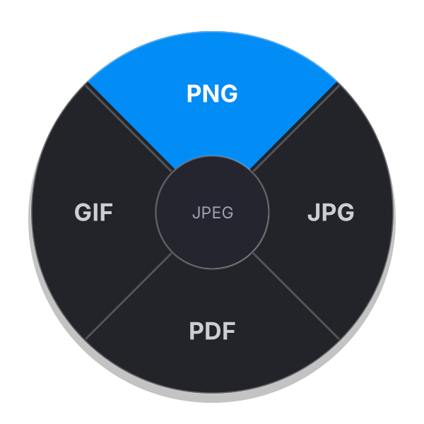

# Radial Convert

Convert files without opening anything. Select files in Explorer or on the desktop, hold **Shift**,
right-click, flick toward a format and let go. The new file appears next to the original.



| Selected | Up | Right | Down | Left |
|---|---|---|---|---|
| Image (jpg, png, gif, webp, heic, avif, bmp, tiff...) | PNG | JPG | PDF | GIF |
| Audio (mp3, wav, flac, m4a, ogg, opus, aiff...) | MP3 | WAV | FLAC | M4A |
| Video (mp4, mov, mkv, avi, webm, wmv...) | MP4 | WebM | GIF | MP3 (audio only) |

- If a file already is a slot's format, that slot shows a spare format instead (WebP for images,
  OGG for audio, MOV for video).
- Let go in the middle, or left-click, to cancel.
- Several files at once work; they convert in parallel at low priority, so games stay smooth.
- Nothing is overwritten: a second copy is named `photo (1).png`.
- Nothing convertible selected? Your normal Shift + right-click menu opens as usual.
- Only Explorer windows and the desktop react. Games and other apps never see the hook.

## Install

```powershell
powershell -ExecutionPolicy Bypass -File install.ps1
```

No admin needed. It builds the exe with the compiler that ships with Windows, installs it to
`%LOCALAPPDATA%\RadialConvert`, downloads FFmpeg next to it, adds it to Startup and starts it.
Remove it with `uninstall.ps1`.

## Change the formats

Tray icon → **Edit formats...** opens `%APPDATA%\RadialConvert\settings.json`. Change any direction to
any format FFmpeg can write and save; the next Shift + right-click uses it. Add your own FFmpeg command
under `recipes`, e.g. `"video>mp4": "ffmpeg -i {in} -c:v libx264 -crf 18 {out}"`.

## Command line (for scripts and other tools)

```
RadialConvert convert --to png a.jpg b.heic     # convert files
RadialConvert menu clip.mov                     # the four formats the menu would show
RadialConvert formats | tools | version
RadialConvert startup on|off
```

## How it works

| File | Job |
|---|---|
| `src/MouseHook.cs` | Low-level mouse hook on its own thread. Holds back Shift + right-click over Explorer/desktop, replays it if nothing convertible is selected. |
| `src/ShellSelection.cs` | Asks Explorer (Shell COM, including Windows 11 tabs and the desktop) which files are selected. |
| `src/RadialMenu.cs` | Click-through per-pixel-alpha overlay, DPI aware; picks the direction from the cursor offset. |
| `src/Converter.cs` | Recipes, FFmpeg runner, safe output naming, FFmpeg discovery. |
| `src/NativeImage.cs` | Built-in PNG/JPG/BMP/TIFF/PDF writer (GDI+), EXIF rotation, white background for JPG/PDF. |
| `src/Config.cs` | `settings.json` with defaults. |
| `src/TrayApp.cs` | Tray icon, menu, notifications, start with Windows. |

Source is C# 5 against .NET Framework 4.8, so it builds with Windows' built-in `csc.exe`
(`scripts/build.ps1`) or with Mono on Linux (`scripts/build.sh`).

## Tests

- Linux/macOS: `tests/run-tests.sh` (needs mono, ffmpeg) converts every category to every format.
- Windows: `tests/run-tests.ps1` after installing.
